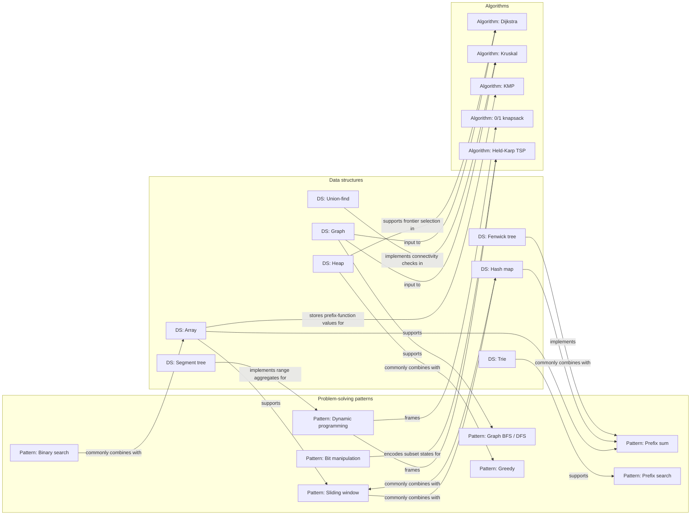
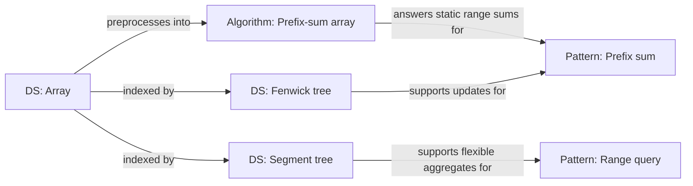
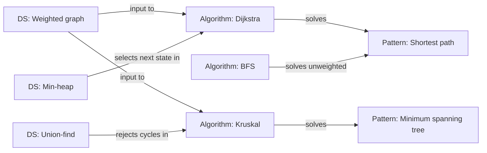
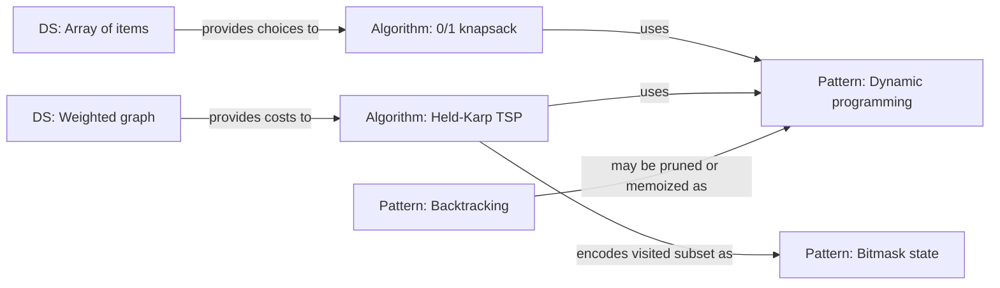

# Data Structures, Patterns, and Algorithms

Node labels identify the kind of concept: **DS** (data structure), **Pattern** (reusable problem-solving approach), or **Algorithm** (a concrete procedure). Relationship labels distinguish “uses” from “implements” and “commonly combines with”; these are common associations, not requirements.

## Overview

## Focus: range queries

Choose a prefix array for static data, a Fenwick tree for point updates and prefix aggregates, or a segment tree for more flexible associative operations.

## Focus: graph optimization

The graph's weight assumptions determine the correct algorithm: BFS for unweighted edges, Dijkstra for non-negative weights, and Bellman–Ford when negative edges must be supported.

## Focus: combinatorial optimization

Related indexes: [data structures](../data-structures/README.md), [patterns](../patterns/related-patterns.md), and [algorithms](../algorithms/README.md).
