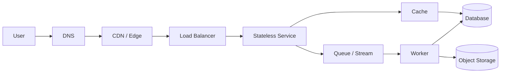

# System-Design Building Blocks

Use each component to satisfy a requirement. Every extra service adds operational cost and a new failure boundary.

## Request path and edge

| Building block | Role | Trade-offs / questions |
| --- | --- | --- |
| DNS | Maps a name to an endpoint | Caching and propagation delay affect failover |
| CDN | Serves cacheable content near users | Cache invalidation, private content, and regional freshness |
| Load balancer | Routes traffic across healthy instances | Health checks, connection draining, and zone/region failure |
| Stateless service | Handles requests without local session ownership | Easier horizontal scaling; state must live elsewhere |

## Storage and asynchronous work

| Building block | Good fit | Trade-offs / questions |
| --- | --- | --- |
| Relational database | Transactions, constraints, relational queries | Vertical limits, indexes and write contention |
| Key-value/document store | Key-oriented access and horizontal partitioning | Query flexibility, consistency, and partition-key hotspots |
| Object storage | Large blobs and immutable media | Separate metadata, authorization, and lifecycle policy |
| Cache | Repeated reads with acceptable staleness | Invalidation, stampedes, hot keys, and cold starts |
| Queue / stream | Buffering, asynchronous work, fanout | Delivery semantics, ordering scope, retry and deduplication |

## Distribution and correctness

- **Partitioning:** split data or work by a key. Choose a key with even distribution and match it to access patterns; plan for hot partitions and rebalancing.
- **Replication:** keep copies for availability and read scale. Define which replica is authoritative and how lag affects reads.
- **Consistency:** strong consistency simplifies some invariants but may cost latency or availability during partitions. Eventual consistency is acceptable only when stale reads fit product behavior.
- **Rate limiting:** bound work per identity or resource. Token bucket allows controlled bursts; fixed windows are simple but can double the effective rate across a boundary.
- **Idempotency:** make retries safe for operations such as payments or order creation. A request identifier is useful only when deduplication state and retention are defined.

## Reliability, security, and operations

- Use timeouts, bounded retries with jitter, circuit breaking, and backpressure; retries without limits can amplify overload.
- Define authentication, authorization, encryption in transit, secret handling, and data retention around trust boundaries.
- Measure latency percentiles, error rates, saturation, queue lag, and dependency health. Logs and traces should carry correlation identifiers without exposing sensitive data.
- Clarify recovery objectives and backups when durability matters; replication alone is not a backup.

## A simple request path

This is a vocabulary map, not a mandatory architecture. A small system may need only a service and database; asynchronous workers, caches, and edge layers should have a stated purpose.

Related structures: [caches, bloom filters, and storage indexes](../data-structures/system-design-structures.md).
