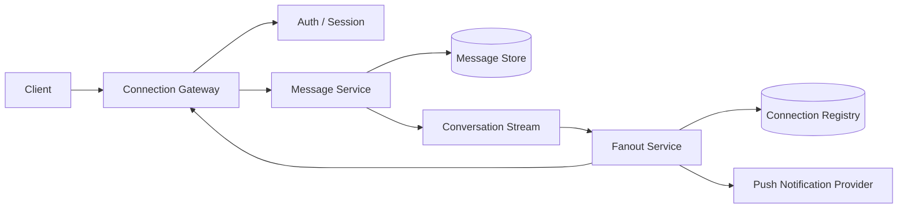

# Case Study: Chat and Messaging

## Requirements

- Send and receive messages in conversations; show history and delivery state.
- Support reconnecting clients, offline delivery, and ordering within a conversation.
- Presence and typing indicators are useful but can be best-effort.

## Rough scale

Assume 10 million daily users, with 1 million concurrently connected. At 20 messages per active user per day, 200 million messages/day is roughly 2.3k writes/s average; peak traffic and fanout can be much higher. Connection count and egress may dominate database writes.

## APIs and data

- `POST /conversations/{id}/messages` with client message ID and body.
- `GET /conversations/{id}/messages?before=...` for paginated history.
- Persistent message: conversation ID, server sequence/time, sender, client ID, body reference, and delivery metadata.

## Architecture

## Scaling and failure modes

- Keep long-lived connections on gateways; use a shared registry to route messages to the gateway holding each recipient.
- Partition messages by conversation and assign a monotonic conversation sequence if strict per-conversation ordering is required.
- Make sends idempotent using the client message ID. Acknowledge only after the chosen durability point.
- On reconnect, fetch from the last acknowledged sequence; do not rely on every socket delivery succeeding.
- Presence can be eventually consistent. Message history should be durable; push notifications are a fallback, not the source of truth.

## Trade-offs

Fanout-on-write lowers read cost for small groups but is expensive for large channels. Fanout-on-read shifts work to clients and reads. A hybrid can use write fanout for ordinary conversations and read-time fanout for very large ones.

Related: [queues and streams](../building-blocks.md#storage-and-asynchronous-work), [graph traversal](../../patterns/graph-bfs-dfs/README.md), and [message ordering](../building-blocks.md#distribution-and-correctness).
