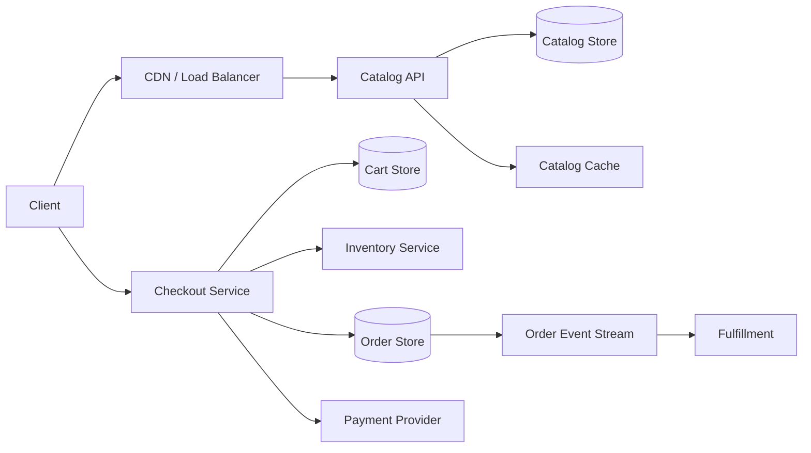

# Case Study: E-commerce

## Requirements

- Browse products, manage a cart, place orders, reserve inventory, and complete payment.
- Prevent overselling; make order creation and payment retries safe.
- Product search and catalog reads can tolerate different freshness from checkout.

## Rough scale

Assume 10 million daily visitors, with a large read-to-write ratio and 100k orders/day (about 1.2 orders/s average). A campaign can multiply peak reads and checkouts; inventory contention on a few popular products is more important than average request volume.

## APIs and data

- `GET /products/{id}` and `GET /search?q=...`.
- `POST /carts/{id}/items` and `POST /orders` with an idempotency key.
- Product, inventory, cart, order, and payment records have distinct ownership and consistency needs.

## Architecture

## Scaling and failure modes

- Cache catalog reads and keep checkout authoritative for stock and price validation.
- Reserve inventory atomically with an expiry; release it when payment fails or times out.
- Use an idempotency key for checkout and persist the outcome so retries return the same order.
- Payment providers and internal services fail independently. Model order states and use compensating actions rather than assuming a distributed transaction.
- Use an outbox or equivalent reliable event publication for order events; alert on stuck reservations and queue lag.

## Trade-offs

Strict inventory checks reduce overselling but can serialize hot products. Optimistic reservation scales better but needs conflict handling. Search indexes and caches improve browse latency but may be stale; checkout revalidates critical facts.

Related: [hash tables](../../data-structures/hash-tables.md), [queues and idempotency](../building-blocks.md#distribution-and-correctness), and [greedy inventory allocation](../../algorithms/greedy-algorithms.md).
