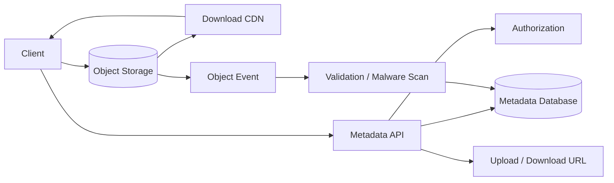

# Case Study: File Storage

## Requirements

- Upload, download, and list files with ownership and access control.
- Support large uploads, retries, metadata, and deletion/retention.
- Keep file bytes durable; metadata consistency may have different requirements.

## Rough scale

Assume 10 million active users averaging 100 files of 1 MB: about 1 PB of raw bytes before replicas, versions, and backups. If 1% of users upload one file per day, that is 100k uploads/day, but bandwidth and object size distribution matter more than request count alone.

## APIs and data

- `POST /files` creates metadata and returns a short-lived upload authorization.
- `POST /files/{id}/complete` confirms upload; `GET /files/{id}` returns metadata/download authorization.
- Metadata: file ID, owner, object key, size, content type, checksum, created time, and lifecycle state.

## Architecture

## Scaling and failure modes

- Send large file bytes directly to object storage using multipart upload; keep the API on the control path.
- Verify checksums and make completion idempotent. Track incomplete uploads for cleanup.
- Do not expose object keys as authorization. Issue scoped, expiring access tokens and re-check permissions for private files.
- Object creation and metadata writes are not necessarily one transaction. Model states such as `pending`, `available`, and `deleting`; reconcile orphaned objects.
- Serve popular downloads through a CDN with an explicit invalidation and private-content policy.

## Trade-offs

Separate blob storage from metadata so each scales appropriately, at the cost of cross-system lifecycle coordination. Deduplication can save storage but complicates privacy, deletion, and ownership guarantees.

Related: [object storage and lifecycle](../building-blocks.md#storage-and-asynchronous-work), [B+ tree indexes](../../data-structures/system-design-structures.md#b-tree-and-b-tree-indexes), and [security](../building-blocks.md#reliability-security-and-operations).
