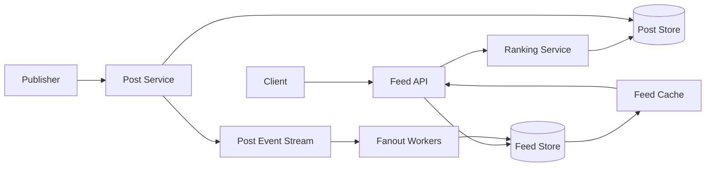

# Case Study: News Feed

## Requirements

- Users publish posts and read a personalized, ordered feed.
- Define freshness, pagination, privacy, and ranking expectations.
- A post should not appear before its authorization/privacy checks pass.

## Rough scale

Assume 10 million daily users and 100 feed reads/user/day: 1 billion reads/day, about 11.6k/s average. Writes may be fewer, but a popular publisher can have millions of followers, making fanout the scaling challenge.

## APIs and data

- `POST /posts` creates a post.
- `GET /feed?cursor=...` returns ranked items and a stable continuation cursor.
- Post data: author, post ID, timestamp, content reference, visibility. Feed entries reference post IDs rather than copying all content.

## Architecture

## Scaling and failure modes

- Fanout-on-write precomputes feeds for ordinary accounts; fanout-on-read handles very large accounts to avoid massive write amplification.
- Use cursor pagination based on stable ordering keys; offset pagination becomes expensive and unstable as new posts arrive.
- Deduplicate entries when combining sources, and re-check visibility on read or use a reliable invalidation path.
- Queue lag makes feeds stale; expose freshness expectations and monitor lag.
- Cache feed pages cautiously because ranking and privacy changes can invalidate them.

## Trade-offs

Precomputed feeds reduce read latency at the cost of storage and write fanout. On-read merging saves fanout writes but increases read latency and work. Ranking may be asynchronous or computed on read depending on freshness and personalization needs.

Related: [queues/streams](../building-blocks.md#storage-and-asynchronous-work), [heaps for top-k ranking](../../data-structures/heaps.md), and [greedy algorithms](../../algorithms/greedy-algorithms.md).
