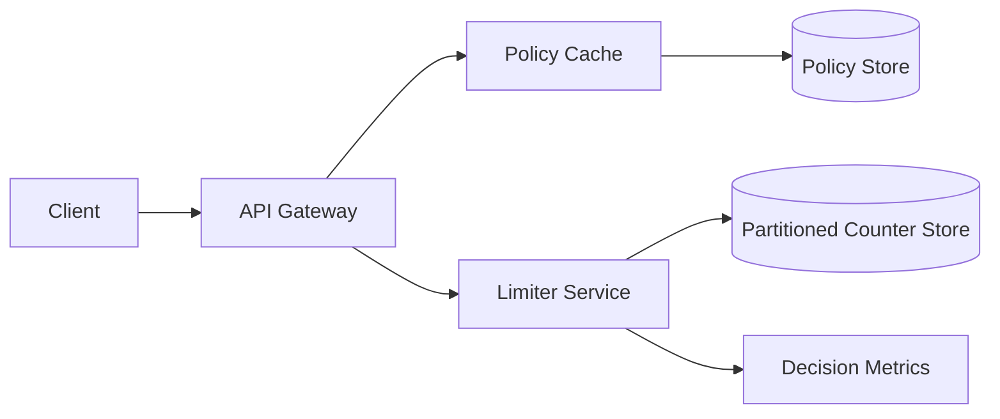

# Case Study: Rate Limiter

## Requirements

- Allow requests under a configured quota per user, API key, or resource.
- Return an allow/deny decision with a retry hint where possible.
- Bound decision latency and fail predictably if the limiter store is unavailable.

## Rough scale

Assume 100k requests/s across several regions, with some identities far hotter than others. At 100 bytes of state per active identity, 10 million active identities need about 1 GB before replication and overhead. Keep state local to the decision path or latency will dominate.

## APIs and data

- `POST /limits/{policy}:check` with identity and cost; return allowed, remaining, and retry-after.
- Policy: algorithm, capacity/rate, window, identity key, and failure mode.
- Token-bucket state: current token count and last-refill time per identity/policy.

## Architecture

## Scaling and failure modes

- Partition state by limiter key; use an atomic script/operation so concurrent checks cannot spend the same token twice.
- A distributed counter can become a hot key. Local token leases reduce coordination but permit bounded overshoot.
- Define fail-open or fail-closed per operation: availability-sensitive reads may fail open; abuse-sensitive or costly writes may fail closed.
- Bound retries and protect the backing store. If policy data is cached, set explicit propagation delay and emergency override behavior.

## Trade-offs

Fixed windows are simple but allow boundary bursts. Sliding logs are accurate but state-heavy. Sliding counters approximate a rolling window. Token buckets allow bursts up to capacity while enforcing a long-term refill rate.

Related: [queues and backpressure](../building-blocks.md#storage-and-asynchronous-work), [caches](../building-blocks.md#storage-and-asynchronous-work), and [system-design structures](../../data-structures/system-design-structures.md).
