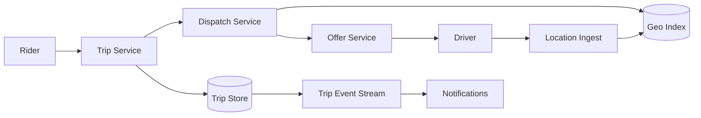

# Case Study: Ride Sharing

## Requirements

- Riders request trips; nearby available drivers receive offers.
- Track trip state from request through assignment, pickup, and completion.
- Location freshness and low dispatch latency matter; payments and trip records must be durable.

## Rough scale

Assume 1 million active drivers sending a location update every five seconds: about 200k updates/s. Updates can be short-lived and geographically partitioned; trip and payment records are much lower volume but require stronger durability.

## APIs and data

- `POST /trips` creates a request with pickup/drop-off.
- `POST /drivers/{id}/location` updates a location with timestamp.
- `POST /trips/{id}/accept` transitions an offer to assigned using a conditional state change.
- Driver location: driver ID, geo-cell, coordinates, timestamp, availability. Trip: rider, driver, state, route, and payment reference.

## Architecture

## Scaling and failure modes

- Partition location indexes by geographic cell; query neighboring cells as radius expands. Expire stale location entries.
- Keep high-rate location updates separate from durable trip state.
- Prevent two drivers from accepting the same trip with an atomic compare-and-set or transaction.
- Use idempotent trip commands and explicit state transitions; retry notifications without duplicating trip assignment.
- Define behavior when location or dispatch is stale, a driver disconnects, or a region is unavailable.

## Trade-offs

Smaller geo-cells reduce candidate scans but increase boundary coordination. Wider matching regions improve supply but can increase pickup time. Strongly consistent assignment protects correctness; location can be eventually consistent within a bounded freshness window.

Related: [partitioning and consistency](../building-blocks.md#distribution-and-correctness), [graphs](../../data-structures/graphs.md), and [heaps](../../data-structures/heaps.md).
