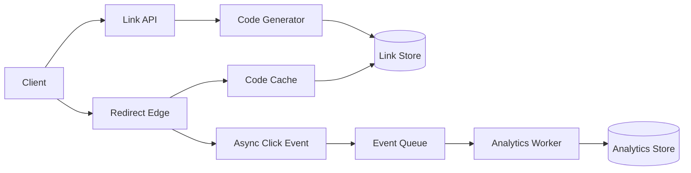

# Case Study: URL Shortener

## Requirements

- Create a short link for a long URL; redirect a code to its destination.
- Optional: expiration, ownership, and coarse analytics.
- Redirect latency and availability matter more than immediate analytics freshness.

## Rough scale

Assume 100 million new links/day and 10 billion redirects/day: about 1.2k writes/s and 116k reads/s on average. Plan for peaks several times higher. If a link record averages a few hundred bytes, raw metadata grows by tens of GB/day before indexes and replication.

## APIs and data

- `POST /links` with URL, optional expiry, and optional requested alias; return code and short URL.
- `GET /{code}` returns a redirect or a not-found/expired response.
- Link record: `code`, destination URL, created time, expiry, owner, and status.

## Architecture

Generate collision-resistant codes (for example, random or encoded unique IDs) and enforce uniqueness in the store. A cache accelerates hot redirects; asynchronous analytics keeps the redirect path short.

## Scaling and failure modes

- Partition link records by code; replicate for availability. Keep cache TTL aligned with expiration and deletion policy.
- A hot viral link can overload one cache key; use request coalescing or short-lived edge caching where appropriate.
- Handle code collisions by retrying after a unique-key conflict. Validate destination URLs and rate-limit creation to reduce abuse.
- If analytics is unavailable, redirect can continue while events are buffered or dropped according to the product's durability requirement.

## Trade-offs

Random codes distribute well but need collision retries. Sequential IDs are compact and unique but reveal volume and require a distributed allocator. Caching improves latency but creates invalidation and freshness questions.

Related: [caches](../building-blocks.md#storage-and-asynchronous-work), [hash tables](../../data-structures/hash-tables.md), and [the URL-shortener variant of key-value lookup](../../algorithms/README.md).
