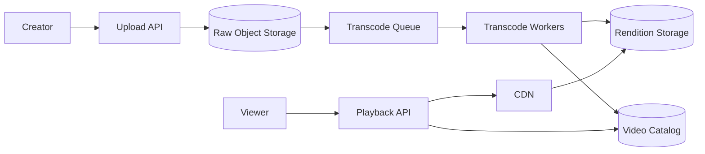

# Case Study: Video Streaming

## Requirements

- Upload, process, discover, and play videos on varied networks and devices.
- Playback startup time and rebuffering matter; uploads must be durable.
- Separate control-plane metadata from large media bytes.

## Rough scale

Assume 100 million plays/day with five minutes watched per play: about 347k average concurrent viewers, with peaks potentially several times higher. At 3 Mb/s average delivered bitrate, average egress is roughly 1 Tb/s; CDN placement and cache hit rate dominate origin bandwidth.

## APIs and data

- `POST /videos` starts upload; `POST /videos/{id}/publish` makes processed renditions available.
- `GET /videos/{id}/manifest` returns an authorized adaptive-bitrate manifest.
- Metadata: owner, title, visibility, processing state, renditions, and object keys.

## Architecture

## Scaling and failure modes

- Transcode asynchronously into multiple resolutions/bitrates; use bounded worker pools and retryable jobs.
- Deliver segments through a CDN using adaptive bitrate streaming. A cache miss should fall back to origin storage without overwhelming it.
- Make publish state explicit so clients do not see incomplete renditions.
- Protect private videos with signed, short-lived playback authorization; avoid putting secrets in publicly cacheable manifests.
- Monitor transcode queue age, startup latency, rebuffer rate, CDN hit rate, and origin egress.

## Trade-offs

More renditions improve device/network fit but increase storage and transcode cost. Longer segments reduce request overhead but worsen startup and adaptation latency. CDN caching reduces origin load but requires a clear invalidation and access-control strategy.

Related: [object storage and CDN](../building-blocks.md#request-path-and-edge), [queues](../building-blocks.md#storage-and-asynchronous-work), and [system-design structures](../../data-structures/system-design-structures.md).
